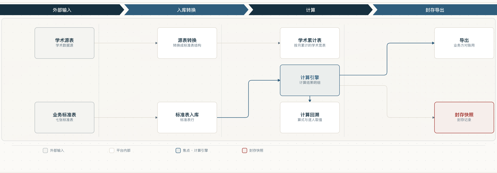
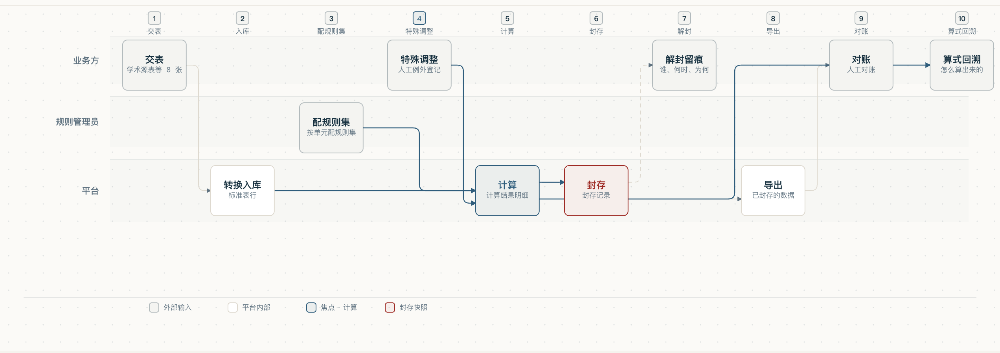

<sub>🌐 <a href="README.md">中文</a> · <b>English</b></sub>

<div align="center">

# system-flow-viz

> *"Type. Hit enter. A finished flow diagram lands in your lap."*
> *「打字。回车。一份能点的流程图落到你手里。」*

[](https://github.com/Ronnietag/system-flow-viz)
[](LICENSE)
[](https://skills.sh)

<sub>Also listed on [skills.sh](https://skills.sh) — the leaderboard for agent skills (listing follows the telemetry delay)</sub>

<br>

**Turn a black-box system into a clickable flow diagram of every runtime path.**

<br>



<br>

Onboarding onto an undocumented system, the hard part is not "what does this function do"
but **"where did this number come from" and "what does changing this move"**.

The method lays out every path as a diagram where each node carries its **source location**
(file + line), **tables read and written**, **how it is triggered**, **measured numbers
(with the date they were taken)**, and a flag whenever **the docs and the code disagree**.

The diagram is **interactive**: hovering highlights the related edges, clicking drills down
layer by layer, and hovering a name reveals its real identifier.

<br>

```bash
npx skills add Ronnietag/system-flow-viz
```

<sub>Installs into opencode / Claude Code / Cursor / Codex / OpenClaw … (20+ agents) · or
<a href="#install-it">git clone</a> into any skills directory</sub>

<br>

Installed, ask your agent *"draw the system flow"* or *"make the platform a black box
disappear"* and it triggers.

<br>

[See it in action](#demos) · [Install it](#install-it) · [The three probes](#the-three-probes-project-agnostic) ·
[Six hard rules](#the-six-hard-rules) · [Drawing rules](#drawing-rules) ·
[Acceptance checklist](references/acceptance-checklist.md)

---

## Install it

### Option 1 · one command (recommended)

```bash
npx skills add Ronnietag/system-flow-viz
```

Installs into **opencode / Claude Code / Cursor / Codex / Cline / OpenClaw / Amp …** (20+ agents)
and registers the skill with the [skills.sh](https://skills.sh) directory — the leaderboard
for agent skills.

### Option 2 · git clone (any agent, any directory)

```bash
git clone https://github.com/Ronnietag/system-flow-viz.git \
    ~/.config/opencode/skills/system-flow-viz
```

⚠️ **Self-check after installing** (the probes need no configuration):

```bash
python3 ~/.config/opencode/skills/system-flow-viz/scripts/probe_endpoints.py \
    --root /path/to/your/repo --glob "**/*.py" --out /tmp/ep.md
```

### How to trigger it

| Say this | What happens |
|---|---|
| *"draw this platform's runtime paths"* | asks about audience/scope/interaction first, then surveys, then produces the interactive diagram |
| *"which table does this page's number come from?"* | page → api wrapper → endpoint → table, each hop with `file:line` |
| *"what does changing this affect?"* | locate the node on the diagram ⇒ list upstream/downstream nodes and their line numbers |

---

## Demos

Two diagrams produced by a real project (the **UI is Chinese**).


**High level** — four stages, one main chain. Hovering a node highlights the related
edges; clicking one opens the panel (what it does / which line of which file /
which table, which field).



**Process flow** — the same drawing primitives arranged as **swimlanes**: who does what
in which step, at a glance.

> ⚠️ A third diagram is deliberately **not** included: the "data lineage" view lists a
> specific project's **table inventory** (its data model) ⇒ out of place in a public
> repository — and it is **data-driven** (a different project shows different tables),
> so it makes a poor general example.

---

## What's in the box

```
SKILL.md                          the method (7 steps + 6 hard rules)
references/
  data-source-schema.md           node-list contract (layers / nodes / edges / the seven blocks)
  acceptance-checklist.md         acceptance checklist
  interview-questions.md          design-tree question list for step 0
scripts/
  probe_endpoints.py              scan route decorators ⇒ endpoint table with file:line
  probe_db.py                     read-only DB probe ⇒ tables / row counts / keys
  probe_config.py                 extract YAML/JSON/TOML config skeletons
templates/
  NodeList.template.tsx           node list, TS flavour (the component imports it)
  nodes.template.json             node list, JSON flavour
  verify_refs.py                  reference verifier (non-zero exit = failure)
test-prompts.json                 trigger regression set (prompt / expected / tests)
demos/                           example diagrams (from a real project)
```

---

## The three probes (project-agnostic)

| Script | What it does | Covers |
|---|---|---|
| `probe_endpoints.py` | scan route decorators ⇒ method / path / handler / `file:line`, plus downstream calls | FastAPI · Flask · Express · Django |
| `probe_db.py` | **read-only** DB probe ⇒ tables / types (table·view·sequence·index) / columns / row counts / keys / unique constraints / samples | DuckDB · SQLite |
| `probe_config.py` | extract config **structure** (not values): top-level keys → nesting → types / required / samples | YAML · JSON · TOML |

⚠️ `probe_db.py` **never writes** (connections are always `read_only=True`); if it cannot
connect it reports "not retrieved + why" instead of guessing.
See [SECURITY.md](SECURITY.md) for the full statement.

---

## The six hard rules

1. **Every path must carry a source location** (file + line) **you verified yourself**
2. **Measured numbers must carry the date they were taken**
3. **When docs and code disagree, follow the code** and flag it explicitly
   ("docs say X / code is Y / where")
4. **Not found ⇒ write "not retrieved, because: X"** — no inference, no filling in
5. **Do not invent** — spot-check the line numbers even when a sub-agent vouched for them
6. **Use the project's own vocabulary** (e.g. `GLOSSARY.md`); never coin terms

---

## Drawing rules

* Edges enter and leave **perpendicular** to the edge they touch; never run along a node border
* Shared edges get **distinct slots** (≥12px apart) — two lines never share a point
* Draw **edges first, nodes second** (the node fill hides the arrowhead)
* Node text is **centred on its content block**, not a hard-coded offset
* Highlighting never changes the **line style** — dashes stay dashes (style means semantics,
  highlight means "related to the current node")
* Width follows the **measured container** (1:1, never scaled); scroll only when narrow

---

## The three seams

| Seam | What it checks |
|---|---|
| ① Types & build | `tsc --noEmit` + the build command |
| ② Reference verifier | source locations exist / line numbers in range / node ids unique / both edge ends exist / measured numbers dated / no placeholders left |
| ③ Live evidence | run the real service + smoke tests, screenshot every page (**interactions too**) |

⚠️ The verifier must be **broken on purpose first** to prove it catches things
(red→green); then fix it back so the exit code returns to zero.

---

## Route changes

| Date | Change |
|---|---|
| 2026-10-29 | First version: taught a static-HTML generator (`templates/build.py`) |
| 2026-11-05 | **Switched to React components** — static HTML cannot be interactive (hover highlight, click to drill), and interactivity is the point. The three probes are unaffected |

---

## Origin

Grown out of a real project: draw the flow of a platform, hit the pitfalls, then distil
the method into a skill. That is why it carries **hard-won lessons** (SVG `className` is
read-only, `onMouseLeave` does not work on SVG in React, antd's default tooltip z-index
(1070) often hides behind a popover, sub-labels truncate silently…).

---

## License

MIT
